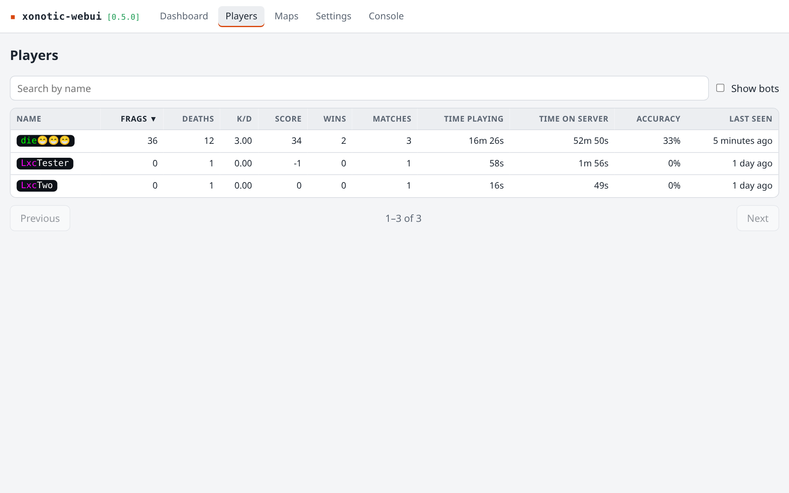
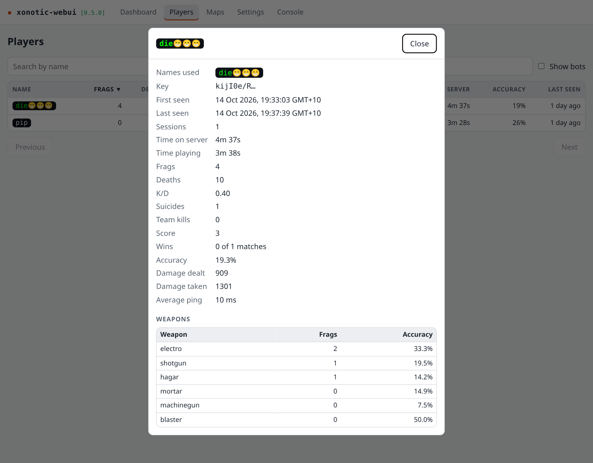
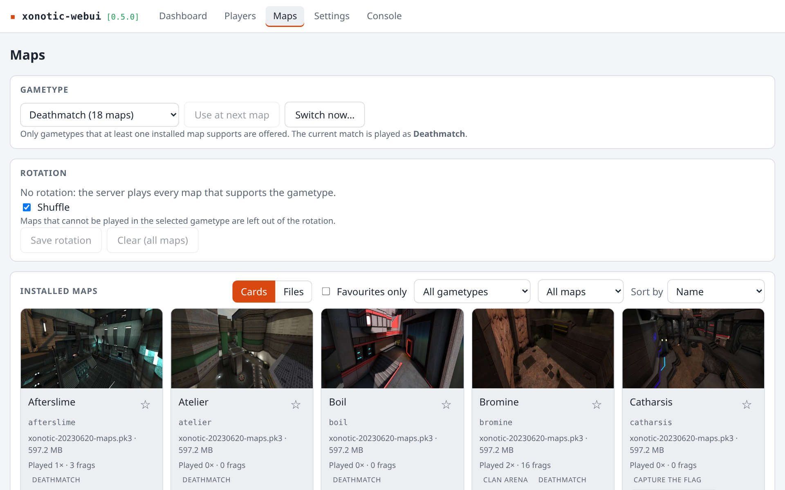
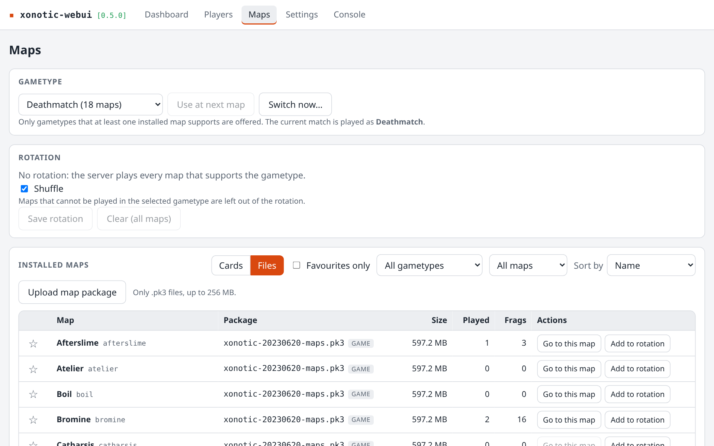
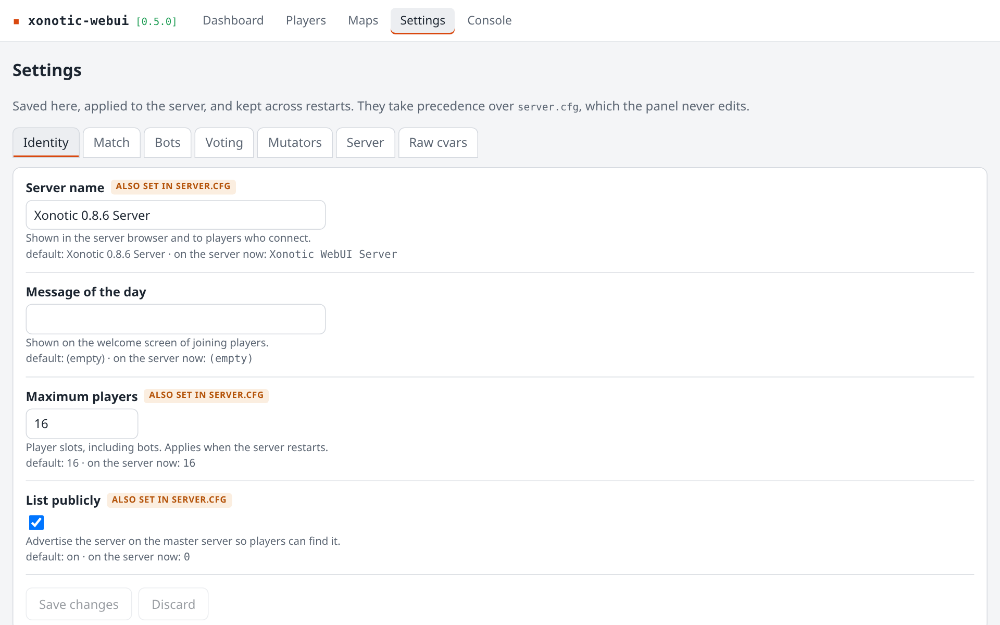

# xonotic-webui

A web control panel for a **Xonotic 0.8.6 dedicated server** on **Linux**. One small Python
service, built for a Proxmox LXC or any Debian 12/13 box on your LAN.

> [!NOTE]
> Built and tested against Xonotic **0.8.6** only. The panel reads the game's console and
> logs, so a newer Xonotic release is untested and may not work.


<table>
  <tr>
    <td></td>
    <td></td>
  </tr>
  <tr>
    <td align="center"><sub>Player history</sub></td>
    <td align="center"><sub>Per-player stats and weapons</sub></td>
  </tr>
  <tr>
    <td></td>
    <td></td>
  </tr>
  <tr>
    <td align="center"><sub>Team games</sub></td>
    <td align="center"><sub>Maps, rotation and favourites</sub></td>
  </tr>
  <tr>
    <td></td>
    <td></td>
  </tr>
  <tr>
    <td align="center"><sub>Upload and manage map packages</sub></td>
    <td align="center"><sub>Server settings</sub></td>
  </tr>
</table>

## Features

- **Dashboard**: start, stop and restart; live match clock and scoreboard
- **Console**: live server output in colour, with a command line
- **Players**: a permanent history with frags, accuracy, wins and per-weapon stats
- **Matches**: every past match with its winner and final scoreboard
- **Maps**: upload `.pk3` packages, set the rotation, star favourites, see what gets played
- **Settings**: change the server without touching `server.cfg`
- **Looks after itself**: restarts after a crash and upgrades itself in one click

## Install

On Debian 12 or 13 (amd64), as root:

```bash
apt-get install -y curl
```

```bash
curl -fsSL https://github.com/carlhako/xonotic-webui/releases/latest/download/install.sh | bash
```

The installer downloads Xonotic 0.8.6 (about 1.2 GB) from `dl.xonotic.org` for you and
checks it against a pinned SHA-256. It prints the web address when it finishes. Run the
same command again to upgrade, or use the one-click upgrade in the panel.

Open **TCP 80** (the panel) to your LAN and **UDP 26000** (the game) to players.

> [!WARNING]
> The panel has **no authentication**. Anyone who can reach it can control the server. Keep
> it on your LAN and never forward its port.

## Documentation

The [guide](docs/guide.md) covers everything else: install options and offline installs,
upgrading and rollback, where files live, server settings, maps, player stats, every
configuration variable, security and development.

## Licence

MIT
