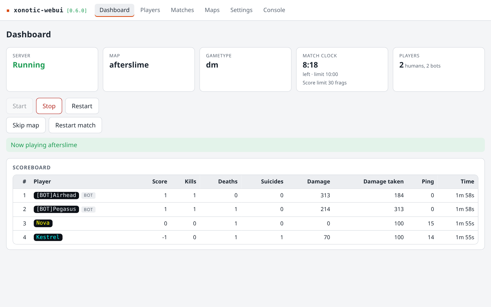
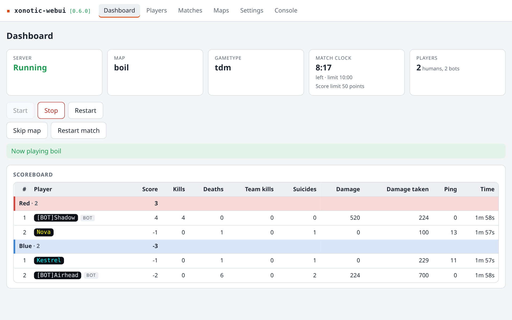
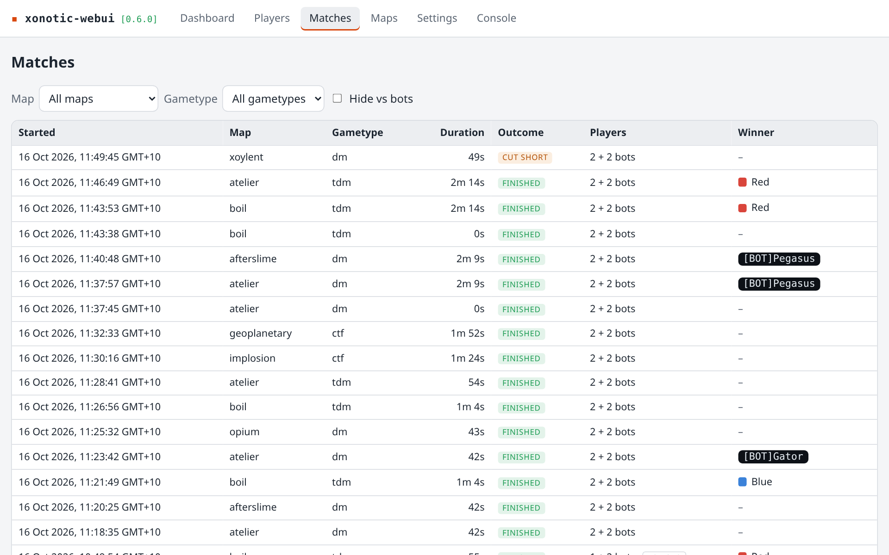
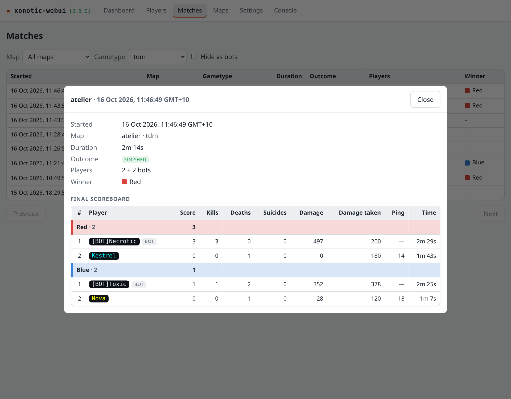

# xonotic-webui guide

The full reference: installing, upgrading, where everything lives, and how each section of
the panel behaves. For the overview and screenshots, see the [README](../README.md).

## Requirements

- Debian 12 or 13, **amd64** (a Proxmox LXC works)
- root, to install; the panel and the game server then run as an unprivileged user
- about **1.2 GB to download** and about **3 GiB of free disk** while installing
- network access to `dl.xonotic.org` (the game), `github.com` (the panel release), the
  Python package index (the panel's dependencies, as prebuilt wheels) and your Debian
  mirror; the offline options below replace the first three

## Install

On a fresh minimal LXC, `curl` is missing, so install it first, then run the installer as
root:

```bash
apt-get install -y curl
```

```bash
curl -fsSL https://github.com/carlhako/xonotic-webui/releases/latest/download/install.sh | bash
```

When it finishes it prints the web address and the game port. The installer is safe to
read first; it is `deploy/install.sh` in this repository.

The installer is the same whether you are installing or upgrading. It refuses to start,
before changing anything, unless it is run as root on a 64-bit x86 Debian-family system
with `apt-get` and, if the game is not yet installed, enough free disk. It then installs `python3`, `python3-venv`, `curl`,
`unzip`, `ca-certificates`, `libstdc++6` and `zlib1g`, creates the unprivileged
`xonotic-webui` user, downloads the game and checks it against a pinned SHA-256, installs
the panel into its own virtualenv and the root upgrade helper (see Upgrading), and enables
and starts the `xonotic-webui` systemd service.

Options are environment variables that must reach `bash`, so put them after the pipe:

```bash
curl -fsSL https://github.com/carlhako/xonotic-webui/releases/latest/download/install.sh | RELEASE_TAG=v0.1.1 bash
```

**Rolling back across 0.6.0.** 0.6.0 moves the player database (`players.db`) to a newer
schema when it first starts, and an older panel refuses that file and runs with player
history off. To go back to 0.5.x or earlier and keep the history, stop the panel, restore a
copy of `players.db` taken before the upgrade (copy it first; the panel does not), and then
roll back. Without a copy, move `players.db` aside and the older panel starts a new history.

| variable | effect |
| --- | --- |
| `RELEASE_TAG=v0.1.1` | install that release instead of the latest |
| `XONOTIC_WEBUI_TARBALL=/path/xonotic-webui.tar.gz` | install the panel from a local release tarball |
| `XONOTIC_ARCHIVE=/path/xonotic-0.8.6.zip` | use a local game archive instead of downloading (still digest-checked) |
| `XONOTIC_WEBUI_WHEELHOUSE=/path` | resolve Python dependencies from a local directory of wheels |
| `XONOTIC_WEBUI_REPO=owner/name` | take the release from another GitHub repository, such as a fork; the upgrade helper and the panel's release check are bound to it too |

The release assets are `install.sh` and `xonotic-webui.tar.gz`. To install without
downloading anything from GitHub or `dl.xonotic.org`, save both from the release page,
fetch the game archive and a wheelhouse yourself, and run the saved script as root:

```bash
XONOTIC_WEBUI_TARBALL=/path/xonotic-webui.tar.gz XONOTIC_ARCHIVE=/path/xonotic-0.8.6.zip XONOTIC_WEBUI_WHEELHOUSE=/path/wheels bash install.sh
```

The installer still uses `apt-get` for the runtime packages in either case.

## Ports

| port | purpose | open it to |
| --- | --- | --- |
| **TCP 80** | web interface (`XONOTIC_WEBUI_PORT`) | your LAN only, see Security |
| **UDP 26000** | the game (`XONOTIC_WEBUI_GAME_PORT`) | players |

Both are the defaults; if you change a port in the settings below, open that one instead.
The installer opens nothing itself, so allow these in any firewall on the host or in front
of it.

## Upgrading

The panel checks GitHub for a newer release shortly after it starts and every 12 hours
after that. The running version is shown in the header, in square brackets beside the name:
green, `[0.2.0]`, when no newer release is known, and orange, `[0.2.0 update available]`,
when there is one. Activating it opens the **Panel** page (`/panel`; it is not in the
navigation bar), which shows the installed and latest versions, when the last check ran, a
**Check now** action, and the latest release's notes.

**One-click upgrade.** When an update is available the Panel page offers *Upgrade to
x.y.z*. Confirming it hands the request to a small root-owned helper, which downloads that
exact release, verifies its published SHA-256 digests and runs its installer. The panel
restarts, and the game server with it: players are disconnected, and the game comes back
by itself if it was running (a server you had stopped stays stopped). The page shows a
banner while this happens, reloads onto the new version, and then reports the outcome. If
the new panel does not come up, the installer restores the previous one and the page shows
the installer's output. Nothing is backed up first: the installer never touches your
configuration, settings or state.

**Without the helper**, and for the one-time step below, upgrade as root, which is the same
command as installing and is safe to repeat:

```bash
curl -fsSL https://github.com/carlhako/xonotic-webui/releases/latest/download/install.sh | bash
```

It replaces the application, fetches the game only if it is missing, and leaves your server
configuration, panel state and logs untouched. The new version is built beside the old one
and checked before the old one is removed; if the new panel does not answer its health
check, the previous version is restored and the installer exits non-zero.

**Installs of v0.1.x have no helper.** Upgrade them once with the command above; that run
installs the helper, and every upgrade after it can be done from the Panel page. Until
then the Panel page shows the command instead of an upgrade button.

**Rolling back** is the same command with the release you want, as root; the interface
never offers a downgrade:

```bash
curl -fsSL https://github.com/carlhako/xonotic-webui/releases/latest/download/install.sh | RELEASE_TAG=v0.1.1 bash
```

**Trust.** The helper is installed by the installer, runs as root only when the panel asks,
and accepts nothing from the panel except a release tag (`vX.Y.Z`) and a request id. The
repository it downloads from is fixed when it is installed (`XONOTIC_WEBUI_REPO` at install
time, `carlhako/xonotic-webui` by default) and a file whose digest is missing or differs is
never run. The panel can write only the request; it cannot change the helper, its units or
the status the helper records.

To stop the panel contacting GitHub at all, set `XONOTIC_WEBUI_RELEASE_CHECK_ENABLED=false`;
the version is still shown, with no update indication, and **Check now** still works.

## Where things live

| path | what |
| --- | --- |
| `/opt/xonotic-webui/venv` | the application, root-owned |
| `/opt/xonotic/0.8.6` | the game tree, root-owned and read-only to the service |
| `/var/lib/xonotic-webui/state.json` | whether the server should be running |
| `/var/lib/xonotic-webui/settings.json` | the server settings saved from the panel (see Server settings) |
| `/var/lib/xonotic-webui/players.db` | the player history, a SQLite database (see Players) |
| `/var/lib/xonotic-webui/favourites.json` | the starred maps, shared by every browser (see Maps) |
| `/var/lib/xonotic-webui/release_check.json` | the last release check, kept so a restart while offline still knows |
| `/var/lib/xonotic-webui/upgrade/request.json` | an upgrade request, present only while the helper has not yet taken it |
| `/var/lib/xonotic-webui/upgrade_pending.json` | the upgrade in flight; `upgrade_last.json` beside it is the last outcome |
| `/var/lib/xonotic-webui/userdir/data/server.cfg` | **your server configuration**, seeded once and never overwritten |
| `/var/lib/xonotic-webui/userdir/data/xonotic-webui-settings.cfg` | generated from `settings.json` on every save and start; do not edit |
| `/var/lib/xonotic-webui/userdir/data/*.pk3` | map packages: uploaded from the Maps section, or copied here by hand |
| `/etc/xonotic-webui/xonotic-webui.env` | optional settings overrides, seeded with commented examples and never overwritten |
| `/etc/xonotic-webui/xonotic-webui.toml` | optional settings file, not created by the installer |
| `/var/cache/xonotic-webui` | the resumable game download, removed once it is verified and extracted |
| `/etc/systemd/system/xonotic-webui.service` | the service |
| `/usr/local/libexec/xonotic-webui/xonotic-webui-upgrade` | the root upgrade helper, root-owned |
| `/etc/systemd/system/xonotic-webui-upgrade.path` | starts the helper when a request appears |
| `/etc/systemd/system/xonotic-webui-upgrade.service` | runs the helper (root, up to 60 minutes) |
| `/var/lib/xonotic-webui-upgrade/status.json` | the helper's recorded outcome, root-owned and read-only to the service |
| `/etc/systemd/system/xonotic-webui.service.d/release-repo.conf` | only when installed from another repository: points the release check at it |

The service is `xonotic-webui` and runs as the unprivileged user of the same name. Everything
under `/var/lib/xonotic-webui` belongs to that user; `/opt` and `/etc` are root's, so the
service cannot modify the application or the game. The panel's own log goes to the journal:
`journalctl -u xonotic-webui`.

You can configure the server in two places, which work together (next section): your
`server.cfg`, and the panel's **Settings** and **Maps** sections.

## Server settings

The panel keeps its own settings in `settings.json` and generates
`xonotic-webui-settings.cfg` from them. The server is started with a wrapper config that
runs, in this order:

1. your `server.cfg`, which the panel **never edits**
2. the generated `xonotic-webui-settings.cfg`
3. the few cvars the panel depends on (the event log, plain colour codes, and where the
   end-of-match statistics report goes)

So **a value saved in the panel wins over the same setting in `server.cfg`**, and nothing
can switch the event log off. A setting that `server.cfg` also sets is marked in the panel,
as far as simple `name value`, `set` and `seta` lines reveal. With nothing saved in the
panel, the server behaves exactly as `server.cfg` configures it. Settings can be changed
while the server is stopped; they are then applied at its next start.

Each saved setting says when it takes effect:

| when | meaning | examples |
| --- | --- | --- |
| **now** | sent to the running server immediately | server name, bots, bot skill, a time limit |
| **next map** | accepted at once, applied when the next map loads | mutators, voting, gametype, going back to a limit's "map default" |
| **next start** | needs a restart | maximum players (the panel offers the restart) |

Limits are written as the game's `*_override` cvars, so they apply to every map and not
just the current match. **Raw cvars** lets you override any other cvar (search the game's
full list, with defaults and descriptions); a raw override is applied after the curated
settings, and may need a map change or restart to take effect. The panel refuses to
override the cvars it forces, the game port and `rcon_password`.

**Match statistics are no longer sent to XonStat.** The panel sets
`g_playerstats_gamereport_uri` to `-` at every start, which makes the game print its
end-of-match report to the console, where the panel reads it (see Players). The game's
default sends that report to `stats.xonotic.org` instead, and the game can only do one of
the two. So matches played here stop counting toward players' public XonStat profiles and
Elo, and the server browser lists the server as using custom stats. The cvar is reserved:
a setting or raw override cannot put it back. The panel's older "Report match statistics"
setting is gone for the same reason.

The panel lists maps from the `.pk3` packages in the game and in `userdir/data`, and keeps
the gametype and the map rotation in `settings.json` too. An empty rotation means every map
that supports the gametype.

Values may not contain a line break, a double quote or a backslash; everything else,
including `;`, `$` and colour codes such as `^1`, reaches the server exactly as typed.

## Maps and match actions

The **Maps** section lists the installed maps (title, supported gametypes, preview) even
while the server is stopped, and lets you choose the gametype and the rotation. Three
actions are also on the dashboard:

| action | what the game does |
| --- | --- |
| **Go to map** | ends the match with the scoreboard, then loads that map; no vote |
| **Skip** | ends the match early; then the game's normal vote (if players are connected and voting is on) or the next map in the rotation |
| **Restart match** | reloads the current map at once and resets scores |

With players connected you are asked to confirm, and told how many are in the match. Each
action is shown as pending to every open browser until the next match actually starts, and
as not completed if none starts within 90 seconds.

**Idle auto-pause stays on.** An empty dedicated server pauses itself a few seconds after a
map loads (the **Pause when empty** setting) and resumes when a player joins; that keeps an
idle server's CPU use near zero. While it is paused the game accepts *go to map* and *skip*
but does nothing until it resumes, so after sending one the panel resumes the server just
long enough to carry it out; the new map pauses itself again. The panel does this only when
nobody is connected, so players never see a pause message, and the pause commands do not
appear in the console.

A map without a `.mapinfo` file is listed with unknown gametypes and is not offered for any
gametype. Changing the gametype takes effect at the next map; to switch immediately, pick a
map for it and the panel goes to that map.

### Live match

While the server is running a match, the dashboard shows the **match clock** and the
**scoreboard**, as you would see them in the game:

- **Clock.** Time left (or counting up when there is no time limit), "Starting in" before
  the match begins, warmup, overtime and match over. It is marked **paused** while the server
  is paused, for example auto-paused with nobody connected, and shows the score limit with
  what it counts (frags, captures, points).
- **Scoreboard.** One row per player, sorted the way the game sorts, with the score columns
  the game reports for the gametype (a capture-the-flag game adds captures, returns and so
  on), ping and time played. Bots are marked, spectators are listed apart, and team games
  show each team's total in the team's colour above its players. It replaces the Players
  online list while it is available.





The panel reads this from the game once a second, **only while a dashboard is open**. Nothing
is sent to the game when no browser has it open or the server is stopped, and the queries
and their replies never appear in the Console section. If the game does not give the clock
or the scores, the dashboard says which one is missing and shows the other.

| route | |
| --- | --- |
| `GET /api/match` | the latest state; does not start the polling |
| `GET /api/match/stream` | server-sent events: the current state, then one per change; reading it starts the polling |

The game leaves bots out of its score dump unless `sv_logscores_bots` is 1, so each poll
raises it for the length of the dump and puts back the value you had. The dump command also
writes to the game's event-log files if you turned on `sv_eventlog_files` yourself (the panel
does not); with that on, the game gets one line a second while a dashboard is open.

### Map packages, the Files view and favourites

The installed maps are shown either as **Cards** (with preview images) or as **Files**, a
plain table with one row per map: the package file it comes from, that file's size, and the
same *Go to this map* and *Add to rotation* buttons. The view is remembered in the browser.

- **Upload** a map package from the Files view. Only `.pk3` files are accepted, up to
  256 MB. The panel checks the file name, that it opens as a package and that it contains a
  map before it installs it into `userdir/data`; a file that fails any check leaves nothing
  behind. A name that is already installed is refused rather than replaced: delete the old
  package first. If an uploaded map has the same name as one already installed, the result
  says which one the game uses.
- **A new map needs a server restart.** The game reads its packages once, when it starts,
  so a package uploaded while the server is running is listed with a note and cannot be gone
  to until the server has been restarted. Uploading while the server is stopped needs
  nothing.
- **Download** and **Delete** are offered for the packages in `userdir/data` only; the
  game's own packages cannot be downloaded or deleted from the panel. Delete asks first and
  names the file, every map in it and which of them are in the rotation.
- **Favourites**: the ☆ on a map card or table row stars it, and *Favourites only* narrows
  both views to the starred maps (it combines with the gametype filter). The list is kept by
  the panel in `favourites.json`, so every browser and device sees the same one.

### How much a map is played

Both views show each map's **Played** and **Frags** figures (`Played 42× · 1,380 frags` on a
card; two columns in the Files table), taken from the player history (see Players).

- **What "played" counts.** A match counts as played when it ran to its limit and someone
  took part in it. A match ended early by a skip, vote or map change does not count, so a
  map that is usually skipped can show 0 played. **Frags** are every frag recorded on the
  map, cut-short matches and bots included. A map that was never played shows 0.
- **Not recorded.** When player history is off or cannot be read, the list still loads and
  both figures show a dash, not 0.
- **Sort by** (Name, Most played, Most frags, Recently played) and the **played filter**
  (Played / Never played, which combines with the gametype and favourites filters) apply to
  both views and are remembered in the browser. Never-played maps come last under
  *Recently played*; with no history the stat-based choices are disabled and the list is by
  name.
- **Details.** Click a map's title for a dialog with its matches played and cut short,
  frags, first and last played, matches per gametype and its ten top fraggers (bots are
  marked). A fragger opens that player's details. The figures are read when the Maps
  section loads and do not update while it is open; reload to see a match that just ended.
  The same details are served at `GET /api/maps/{name}/stats`.

## Players

The **Players** section keeps a history of everyone who plays on the server, in
`/var/lib/xonotic-webui/players.db` (SQLite, under the same state directory as everything
else). It is recorded from the game's own event log and end-of-match report, with no extra
process, and survives restarts, crashes and upgrades. History is **kept forever**; nothing
is purged.

- **Who is who.** A human is identified by the key fingerprint the server reports for their
  connection, so a rename or a new address keeps one history. Xonotic clients make a key on
  first run, and nobody can present another player's. A player with no fingerprint is
  identified by their name with colours removed, so two keyless players called `Player` are
  one history. Every name a player has used is kept, and searching matches any of them.
  Bots are recorded by name and marked; they are hidden unless you turn on **Show bots**.
- **Time on server and time playing.** *Time on server* is how long someone was connected,
  spectating included, and runs through map changes. *Time playing* is the time they were
  alive in matches, as the game reports it at match end. A server that stops or crashes ends
  every session at that moment.
- **Counts as they happen.** Frags, deaths and suicides are counted from the event log
  live. The rest (score, wins, finished matches, damage, per-weapon accuracy, achievements,
  average ping) is added when a match ends, including one cut short by a map change or a
  clean stop. A crash loses that match's report but nothing already counted.
- **Matches played.** A match counts toward a player's **Matches** (and can count as a win)
  only when it ran to its limit *and* the player was on the final scoreboard, playing, when
  it ended. When they joined does not matter, so someone who came in half way and was still
  playing at the end gets it. A player who left early, was spectating at the end, or whose
  match was cut short does not, though their frags, time and damage from that match still
  count. A match against bots counts like any other.
- **The table.** Click a column to sort by it and again to reverse it; the search, sort and
  page are kept in the address, so a link restores the view. It refreshes by itself every
  few seconds while open. Click a row for a player's details: names used, first and last
  seen, sessions, matches played and wins, a per-weapon table and achievements. **View
  matches** in that dialog opens the Matches section for that player.
- **What is not kept.** No IP addresses are stored, and only the first eight characters of
  a key fingerprint are ever shown.

The report lines are not shown in the **Console** tab. They are the reason XonStat
submission stops (see Server settings).

## Matches

The **Matches** section lists every past match, newest first, a page at a time, from the same
player history (`players.db`). It refreshes by itself every few seconds while open, so a
match that ends appears without a reload, and it keeps your filters and page.

- **What is listed.** Every match that at least one human took part in. A human took part
  when they have a recorded frag, death, suicide or team kill in it, or appear in its
  end-of-match report. A match with only bots, or nobody, is not listed. Someone who joined,
  did nothing and left before the match ended is never recorded, so a match like that can
  show one human and still be tagged **vs bots**.
- **The columns.** When it started, map, gametype, duration, how it ended, who took part
  (`1 + 3 bots`), the winner and the **vs bots** tag.
- **How it ended.**
  - **Finished**: it ran to its limit.
  - **Cut short**: ended early by a skip, a vote, a map change or a clean server stop.
  - **In progress**: it is the match being played now.
  - **No report**: it ended without an end-of-match report, which is what a crash does. Only
    frags, deaths, suicides and team kills are known for it.
- **The winner.** The winning team in a team game, with its colour, otherwise the winning
  player (`Ace +2` when more players share a win). A match that was cut short, has no report
  or was drawn has none, shown as a dash.
- **vs bots.** Exactly one human and at least one bot took part. It is worked out from who
  is recorded in the match, so matches from before this section existed are tagged too, and
  they count toward player totals like any other match.
- **Filters.** Map, gametype and **Hide vs bots**, which combine. They and the page are kept
  in the address, so a reload or a shared link restores the view. A **Player** chip, which
  you get from **View matches** in a player's dialog, narrows the list to the matches that
  player took part in, including ones they left early; remove it to see everything again.
  The unknown gametype is offered for matches recorded without one.
- **Details.** Click a match for a dialog with its summary and final scoreboard: the game's
  own columns in the game's order (score, kills, deaths and suicides always, then any other
  value someone scored, such as captures), with ping and time playing. Team games group the
  players under their team's totals in the team's colour. A player who left early, or was
  spectating when the match ended, is listed last and marked **not at end**. Names are the
  ones used in that match, with colours. Click a player to open their details.
- **Older matches.** A match recorded before the panel kept full scoreboards (that is, before this section
  existed) shows the figures that were kept for it, without team grouping or team scores, under
  each player's current name. The dialog says so. Nothing is rebuilt for them.
- **Not recorded.** When player history is off or cannot be read, the section says so.
- **Storage.** A match keeps about 10 to 20 small rows per player. History is kept forever
  like the rest, so a busy server's file grows by a few tens of megabytes per 10,000 matches.





The same data is served at `GET /api/matches` (filtered with `map`, `gametype`, `player`,
`vs_bots`, `limit` and `offset`; the answer has an ETag) and `GET /api/matches/{id}`.

## Settings

Environment variables (put them in `/etc/xonotic-webui/xonotic-webui.env` as `KEY=value`),
or a TOML file at `/etc/xonotic-webui/xonotic-webui.toml` (or the path in
`XONOTIC_WEBUI_CONFIG_FILE`) with the same names, lower-case and without the prefix, for
example `port = 8080`; they may be at the top level or under an `[xonotic_webui]` table.
Environment wins over the file. Restart the panel after changing either:
`systemctl restart xonotic-webui`.

| variable | default | meaning |
| --- | --- | --- |
| `XONOTIC_WEBUI_PORT` | `80` | web interface port |
| `XONOTIC_WEBUI_HOST` | `0.0.0.0` | address the web interface binds |
| `XONOTIC_WEBUI_GAME_PORT` | `26000` | UDP game port |
| `XONOTIC_WEBUI_GAME_ROOT` | `/opt/xonotic/0.8.6` | the extracted game tree |
| `XONOTIC_WEBUI_STATE_DIR` | `/var/lib/xonotic-webui` | panel state and the game's userdir |
| `XONOTIC_WEBUI_SHUTDOWN_TIMEOUT` | `60` | seconds to wait for a clean exit before forcing |
| `XONOTIC_WEBUI_READINESS_TIMEOUT` | `120` | seconds to wait for the server to become ready |
| `XONOTIC_WEBUI_CRASH_RESTART_THRESHOLD` | `3` | crashes in the window after which automatic restart is abandoned; `0` disables it |
| `XONOTIC_WEBUI_CRASH_RESTART_WINDOW` | `300` | the window, in seconds |
| `XONOTIC_WEBUI_CRASH_RESTART_DELAY` | `2` | seconds to wait before an automatic restart |
| `XONOTIC_WEBUI_CONSOLE_BUFFER_LINES` | `2000` | console lines kept for new viewers |
| `XONOTIC_WEBUI_RELEASE_CHECK_ENABLED` | `true` | check GitHub for a newer panel release; `false` for a host with no internet |
| `XONOTIC_WEBUI_RELEASE_CHECK_INTERVAL_HOURS` | `12` | hours between release checks |
| `XONOTIC_WEBUI_RELEASE_REPO` | `carlhako/xonotic-webui` | the GitHub repository whose releases are checked; the installer keeps it in step with the helper |
| `XONOTIC_WEBUI_RELEASE_API_URL` | `https://api.github.com` | the GitHub API base URL |
| `XONOTIC_WEBUI_UPGRADE_HELPER_PATH` | `/usr/local/libexec/xonotic-webui/xonotic-webui-upgrade` | where the panel looks for the helper; its presence enables one-click upgrade |
| `XONOTIC_WEBUI_UPGRADE_STATUS_DIR` | `/var/lib/xonotic-webui-upgrade` | the helper's root-owned status directory |
| `XONOTIC_WEBUI_UPGRADE_TIMEOUT_SECONDS` | `3900` | how long the panel follows the helper before calling an upgrade interrupted; keep it above the unit's `TimeoutStartSec` (60 minutes) |
| `XONOTIC_WEBUI_USER_AGENT` | `xonotic-webui/<version> (+https://github.com/<repo>)` | the user agent of the release check |
| `XONOTIC_WEBUI_CONFIG_FILE` | `/etc/xonotic-webui/xonotic-webui.toml` | the TOML file to read; only meaningful as an environment variable |

The service unit itself sets `XONOTIC_WEBUI_GAME_ROOT` and `XONOTIC_WEBUI_STATE_DIR` in the
environment, so under systemd the TOML file cannot change them; set them in the `.env` file.

If you raise `XONOTIC_WEBUI_SHUTDOWN_TIMEOUT`, raise `TimeoutStopSec` in the unit by the
same amount (the unit's comments explain the arithmetic).

## Security

The panel has **no authentication** and no TLS. Anyone who can reach its port can start
and stop the server and send it console commands. Run it on a trusted LAN, do not forward
its port from your router, and expose only the game's UDP port to the internet. The
binding address is configurable if you want to restrict it further.

The panel also **accepts file uploads**: anyone who can reach it can write map packages
(`.pk3`, up to 256 MB each) into the game's user directory and delete the ones there. That is
no more open than the console, which already runs any command on the game server, but it
is one more reason not to expose the port. A map package may carry a `maps/<name>.cfg` that
the game runs when the map loads, so only upload packages you trust. If you put a reverse
proxy in front of the panel, raise its request body limit to at least 256 MB (nginx:
`client_max_body_size`), or uploads will be refused by the proxy.

## Development

```bash
python3 -m venv .venv
.venv/bin/pip install -e '.[dev]'
.venv/bin/pytest
```

```bash
npm --prefix web ci
npm --prefix web test
npm --prefix web run build
```

`npm run build` writes the interface into `src/xonotic_webui/static/`, which the panel
serves and the wheel carries. To work on the interface with live reload, run the panel on
an unprivileged port and point the dev server at it:

```bash
XONOTIC_WEBUI_PORT=8000 .venv/bin/python -m xonotic_webui
```

```bash
XONOTIC_WEBUI_PORT=8000 npm --prefix web run dev
```

After changing an API route or model, regenerate the schema snapshot and the front end's
types (a test fails until you do):

```bash
.venv/bin/python scripts/export_openapi.py
npm --prefix web run gen:api
```

The tests never need the 1.2 GB game: a fake dedicated server (`tests/fake_xonotic`)
replays output captured from the real one (`tests/fixtures/xonotic`).

This project was bootstrapped with [OpenSpec](https://openspec.dev); the specifications and
design decisions are in `openspec/`.
